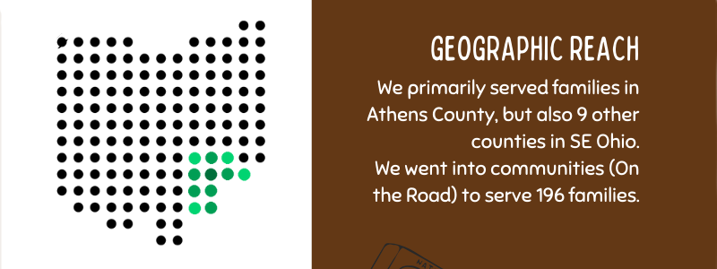
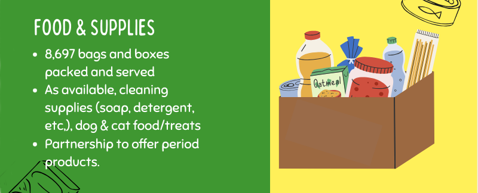
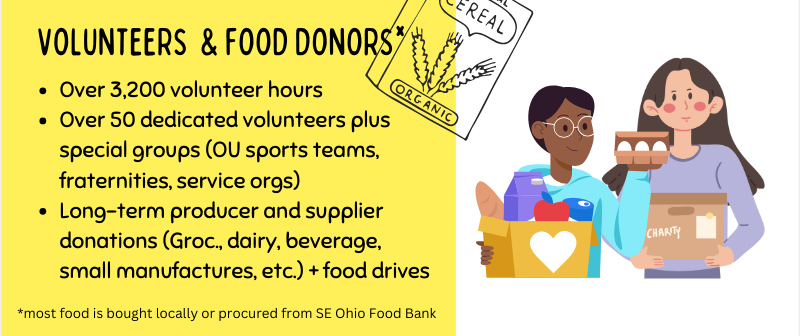

## How did we do in 2023?

We looked back and collected some key facts about our work.

## We served more families

With continued high grocery prices, it's no surprise that demand has risen. We hear from seniors on disability who have high prescription prices, or working families whose budgets don't stretch enough. Yet, the average family visits us only three times a year, up from a bit more than two times in 2022.

Rural transportation is a challenge, although last year we served at least a few families from every county in SE Ohio. Our On the Road Program continues to be helpful for those that either can't get to our main location during the week, or need a location closer to where they live. We rotate between Albany, Jacksonville/Trimble and New Marshfield.

## What we provide

Our bags and boxes contain non-perishable food for breakfast (for example, cereal), lunch (PB & J), and dinner (pasta, canned veggies, etc.). We also provide a frozen protein choice (hot dogs, ground beef, frozen fish, etc.). When available, we'll add dairy (cheese, butter, or sometimes milk), bread, and fresh produce. If resources and labor permit, we sometimes have cleaning supplies. To support our feline and canine friends, we'll provide dog and cat food or treats when we have them.

## How we do it

First, we are thankful for the many volunteers and organizations that help us do this work. We not only rely on our regular volunteers, but have received the support of local groups, teams, and even families. Some help us directly, while others raise money or donate food and supplies.

We are especially appreciative of the extras that local businesses and organizations send our way. As available, we receive from Kroger, Snowville Creamery, Shagbark Seed and Mill, Milo's, the local Pepsi distributor, and too many others to mention them all. Produce is provided either from the Food Bank, or, for local produce, in partnership with Rural Action and Community Food Initiatives. We even get a supply of banana boxes, perfect for filling with food!

## Our backbone – financial donors

Although we receive donations of food, most of the food we provide comes from the SE Ohio Foodbank, where we pay a shared service fee, or it is bought locally, where we buy food at local grocery stores. We couldn't keep our shelves full without the donations we receive. Church groups, civic organizations, businesses and individuals all provide these vital funds. For a detailed list, visit our [donors page](/donors). We also receive donations "in memory of" and "in honor of".

## President's Message

On behalf of the board, let me thank you for your support of our work in our community. Working to alleviate hunger and food insecurity has been a full time job for our volunteers and the past year has seen continued increases in the numbers that we serve.

We know how important our work is, not just to distribute food but to be a friendly and caring presence. Our volunteers are just that: friendly and caring. And while that makes those we serve feel a bit better about their visit it can be hard on our volunteer team. The stories we hear, the needs that we see can take a toll but you would never know it when you see them at work.

I am so proud of the entire team, the packers and the distribution gang, and I know you would be too. So when you read this or when you sit down to dinner, remember those great volunteers and the work they do for our mission:

> Helping our neighbors with food and support

Karin
